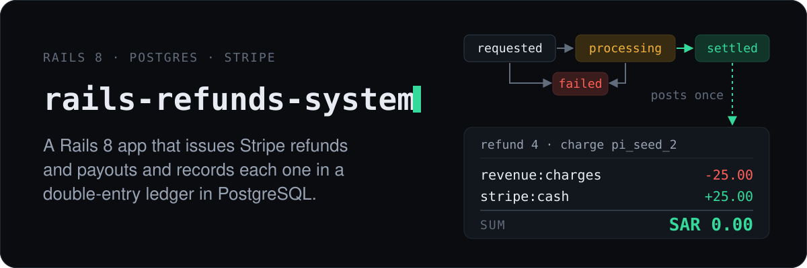
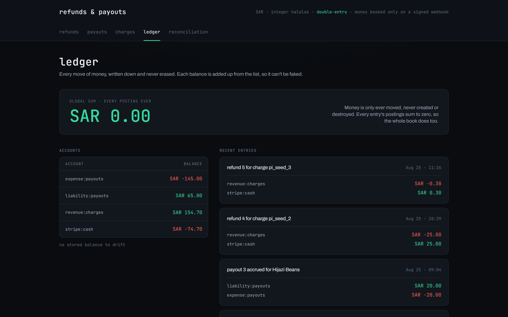
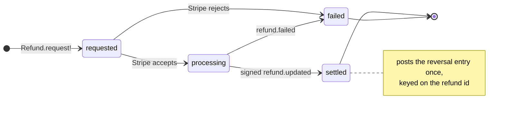
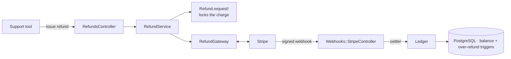

<div align="center">



[](https://rails-refunds-system.onrender.com)
[](https://github.com/MohammedAltounsi/rails-refunds-system/actions/workflows/ci.yml)


### [▶ Open the live demo](https://rails-refunds-system.onrender.com)

In the demo you can issue a refund, replay the settlement webhook, and look
at the ledger. It runs in Stripe test mode, so you don't need a Stripe account.



</div>

> [!NOTE]
> The demo runs on Render's free tier. If it has been idle, the first load takes about a minute while it wakes up.

A Rails 8 app that handles Stripe refunds and payouts. Each refund goes
through a state machine, and every money movement is written to a double-entry
ledger in PostgreSQL.

It is the companion to
[rails-stripe-wallet-ledger-sandbox](https://github.com/MohammedAltounsi/rails-stripe-wallet-ledger-sandbox),
which handles incoming payments (capturing a payment and crediting a wallet).
This repo handles money going back out. It covers partial refunds, redelivered
webhooks and retried requests, and in each case the refund is booked once.

## How it works

Refunds follow the state machine below. Any transition that isn't drawn here
raises `Refund::InvalidTransition`.



The webhook handler is less strict than the state machine. Stripe can deliver
events out of order, so a verified success event moves any unsettled refund to
`settled` and books it once. A failure event that arrives after the refund has
settled is ignored, so it can't undo the booking.

The request path:



1. `Refund.request!` locks the charge, checks the remaining refundable amount,
   and creates the refund row, idempotent on a caller-supplied key.
2. `RefundGateway` calls Stripe. The refund moves to `processing`. A
   synchronous Stripe error fails it immediately; nothing is booked either way.
3. Stripe's `refund.updated` webhook (signature-verified, deduped through the
   inbox) is the only thing that calls `Refund#settle!`, which flips the
   status to `settled` and posts the balancing reversal in one transaction.
4. If a webhook is redelivered, a request is retried, or someone
   double-clicks, the money still moves once. Idempotency keys handle this in
   the app, and unique indexes and a trigger enforce it again in the database.

For the reasoning behind each decision, see [ARCHITECTURE.md](ARCHITECTURE.md).
For what to do when reconciliation reports drift, see [RUNBOOK.md](RUNBOOK.md).
For every route this app exposes, see [API.md](API.md).

## Run it

The quickest option is the [live demo](https://rails-refunds-system.onrender.com).
It runs the whole refund flow in the browser and can replay webhooks for you.
To run it locally against Stripe test webhooks:

Needs Ruby 4.0+, the [Stripe CLI](https://stripe.com/docs/stripe-cli), and a Stripe test account.

```bash
bundle install
bin/rails db:setup
```

Put your test key in `.env.local` (gitignored):

```
STRIPE_SECRET_KEY=sk_test_...
STRIPE_WEBHOOK_SECRET=whsec_...
```

Run the app and the webhook tunnel in two shells:

```bash
bin/rails server
stripe listen --forward-to localhost:3000/webhooks/stripe --events refund.updated,refund.failed
```

Open <http://localhost:3000> and issue a refund from `/refunds/new`. It
settles when the webhook arrives. Then check `/ledger` and `/reconciliation`.

## What it does

| Area | What happens | Where |
|---|---|---|
| Refund state machine | `requested → processing → settled \| failed`. Every other transition raises `Refund::InvalidTransition`. | `app/models/refund.rb` |
| Over-refund guard | The refunds on a charge can't add up to more than it captured, including when requests run at the same time. The app checks this under a row lock on the charge, and Postgres checks it again with a deferred `CONSTRAINT TRIGGER`. | `Refund.request!`, `lib/tasks/db_constraints.rake` |
| Idempotent reversals | Settling a refund posts a reversal entry keyed on the refund. A redelivered webhook doesn't post a second one. | `Refund#settle!`, `app/models/ledger.rb` |
| Stripe refunds | Created through the Refund API in test mode. The ledger entry is posted when a signature-verified `refund.updated` webhook arrives. The synchronous create response doesn't post anything. | `app/models/refund_gateway.rb`, `app/controllers/webhooks/stripe_controller.rb` |
| Webhook inbox | Each Stripe event is stored once (unique `event_id`). Redelivering an event that was already processed does nothing. | `app/models/stripe_event.rb` |
| Payouts | Payments out to a payee. Requesting a payout records the liability in the same transaction. The cash is paid out when a verified `payout.paid` webhook arrives. Payouts use the same idempotency keys, state machine and double-entry postings as refunds. | `app/models/payout.rb` |
| Reconciliation | Compares settled refunds against Stripe and reports dropped webhooks, amount mismatches and orphan reversals. Each run is saved, so you can see when drift started. If Stripe is down, the run reports `unreachable` and doesn't flag orphans. | `app/services/reconciliation_service.rb`, `app/models/reconciliation_run.rb` |
| Recovery sweep | A job re-runs any webhook event that is still unprocessed, for example a settlement interrupted by a crash. | `app/jobs/reprocess_stuck_stripe_events_job.rb` |
| JSON API | `POST /api/refunds` accepts an `Idempotency-Key` header and handles it the same way Stripe's API does. The spec is at `/openapi.yaml`. | `app/controllers/api/refunds_controller.rb` |
| Audit + access | Each refund and payout records who issued it and what they did. Actions that move money need Basic auth when `ADMIN_PASSWORD` is set. | `app/models/audit_log.rb` |

## Tests

```bash
bin/rails test
```

Covers every legal and illegal state transition, the over-refund guard (both
the app-level lock and, on Postgres, the DB trigger), idempotent reversals
under a redelivered webhook, webhook signature verification, and each
reconciliation drift mode. CI runs the suite on Postgres so the deferred
triggers and row locks get tested, and it runs Brakeman and bundler-audit on
every push.

## Security

- Webhooks are signature-verified before any money moves.
- Content Security Policy, `force_ssl` with HSTS, and a host allowlist.
- rack-attack throttles the refund-issuing endpoint.
- Secrets come from environment variables. The credentials key is not in the repo.
- CI fails a push if Brakeman or bundler-audit finds a problem.

## Author

**Mohammed Altounsi**

I build payment systems and e-commerce stores, plus the web apps and
marketing around them. This repo and the wallet ledger repo are examples of
my payments work.

- LinkedIn: <https://www.linkedin.com/in/mohammed-altounsi/>
- GitHub: [@MohammedAltounsi](https://github.com/MohammedAltounsi)
- Email: mhmdaltounsi@gmail.com

## License

MIT. See [LICENSE](LICENSE).
